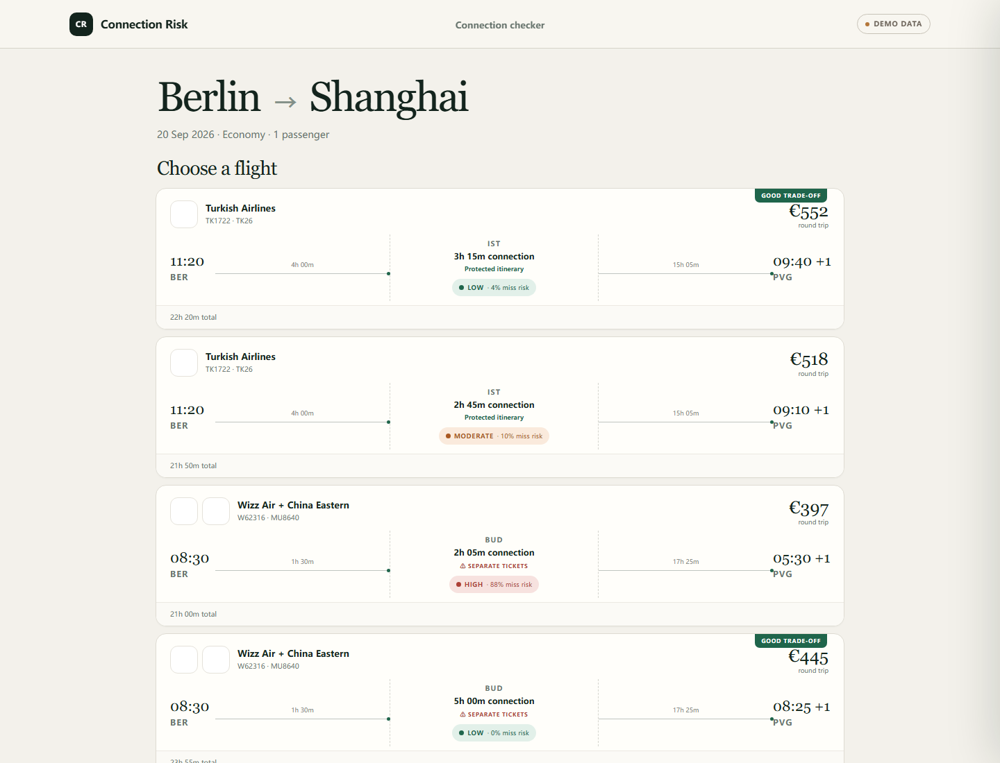
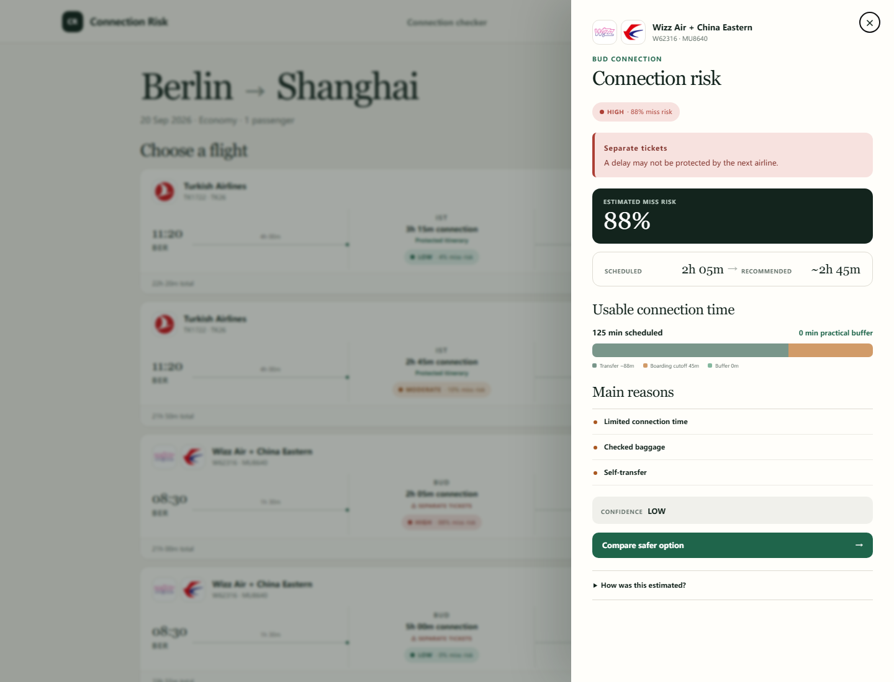
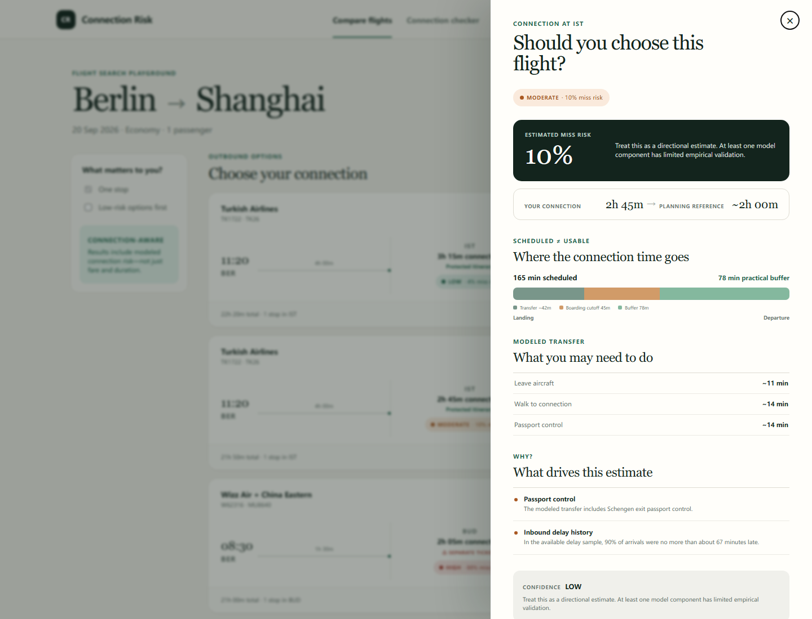
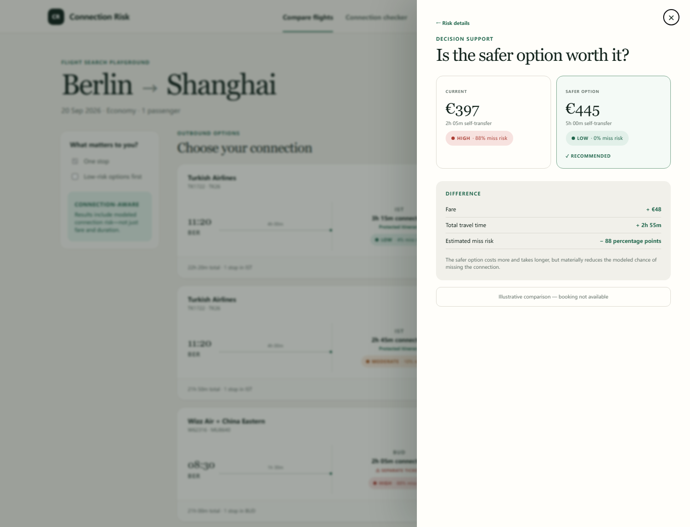
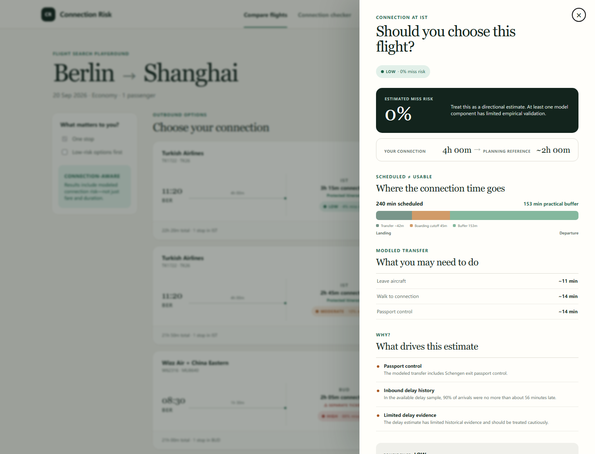

# UX-first v0.4 playground

The flight-shopping playground is served at `/demo`. It is deliberately separate
from the direct checker at `/` and uses five centralized deterministic fixtures
from `connection_risk.demo`. Fares, schedules, and flight identities are
illustrative; risk values are computed through `RiskEngine` and
`interpret_risk_result` on every API request.

## Product critique that shaped the work

What worked before: a structured consumer response, clear unsupported states,
confidence metadata, and one engine shared by the checker and extension.

What felt developer-oriented: the primary web journey began with schedule fields,
and the extension exposed an isolated utility panel. Neither resembled the moment
when a traveler compares options.

What blocked flight-shopping credibility: risk was not visible inside an itinerary,
scheduled and usable time were not visually distinguished, separate-ticket
consequences were easy to miss, and there was no safer-option trade-off.

The playground therefore makes the hierarchy Flight → Connection → Risk → Decision
visible on one page. The drawer is an explanation surface, not a dashboard.

## Deterministic review URLs

- `/demo` — search results
- `/demo?view=self-transfer-high` — high-risk separate tickets
- `/demo?view=protected-tight` — moderate-risk detail
- `/demo?view=self-transfer-high&compare=1` — safer-option comparison
- `/demo?view=low-confidence` — limited delay evidence

## Captured review screens

## Data truthfulness

The playground always says `Demo data`; it never implies that its fixture schedules
or fares are live. A locally configured ADRR dataset remains historical research
data and is surfaced that way in the direct analysis path. OurAirports supplies
airport identity and code mapping only, never transfer times.
